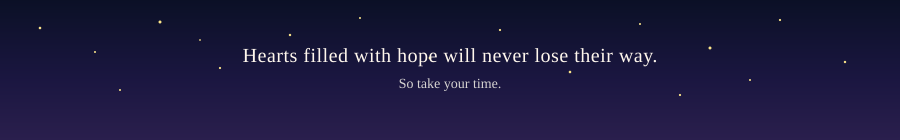
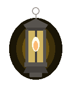

  

  

### hey guys, i'm james!!! welcome, and feel free to have a look around!

React & JavaScript developer! Fun Fact: I love hot chocolate! ☕🍫  
Building [**The Lantern**](https://github.com/JamezM546/the-lantern) and other fun side projects when I can 😎

### 🏮 projects 🏮

- [**The Lantern**](https://github.com/JamezM546/the-lantern) · manga tracker (AniList API)
- [**Anaphor**](https://github.com/JamezM546/Anaphor) · real-time chat + AI summaries
- [**Merck Doc Compare**](https://github.com/JamezM546/Merck-Document-Comparison) · DOCX comparison tool
- [**MainPortfolio**](https://github.com/JamezM546/MainPortfolio) · [**Lock System**](https://github.com/JamezM546/lock-system) · [**Recipe Finder**](https://github.com/JamezM546/my-recipe-finder)

 

### 🕯️ toolkit  🕯️

  

  <i>come sit by the lantern awhile 🪵🔥</i>

